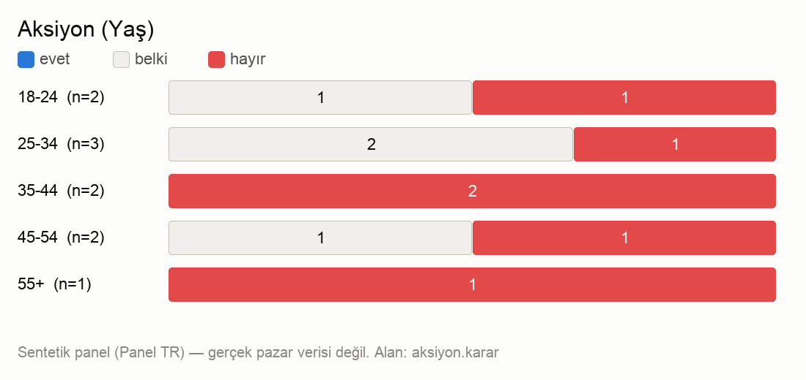
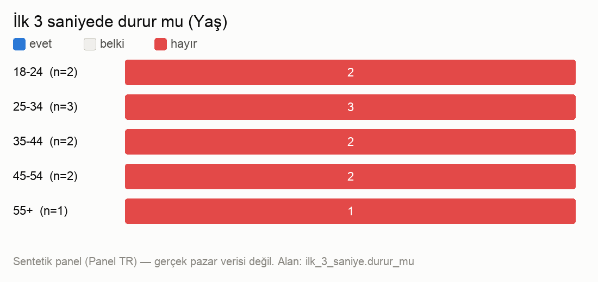

# Panel verisi (viewer, 10 kişi, 2 grup) — Panel TR 1.0.0 lite

Script tarafından sayıldı. Sentetik panel: gerçek pazar verisi değildir.

**Toplam:** ilk 3 sn'de durur 0/10 · aksiyon evet 0 / belki 4 / hayır 6 · güvenilirlik ort. 2.8/5

### Yaş

| grup | n | ilk 3 sn durur | aksiyon evet | belki | hayır | güven ort. |
|---|---|---|---|---|---|---|
| 18-24 | 2 | 0/2 | 0/2 | 1 | 1 | 3 |
| 25-34 | 3 | 0/3 | 0/3 | 2 | 1 | 3 |
| 35-44 | 2 | 0/2 | 0/2 | 0 | 2 | 2.5 |
| 45-54 | 2 | 0/2 | 0/2 | 1 | 1 | 2.5 |
| 55+ | 1 | 0/1 | 0/1 | 0 | 1 | 3 |

## Güvenilirlik kontrolleri

- Kelime örtüşmesi (itiraz+düzeltme, Jaccard): grup içi 0.04, gruplar arası 0.04 → grup içi ve gruplar arası benzerlik yakın (belirgin tek seslilik yok)
- Dayanak / şema / kart yankısı sorunları: 0
